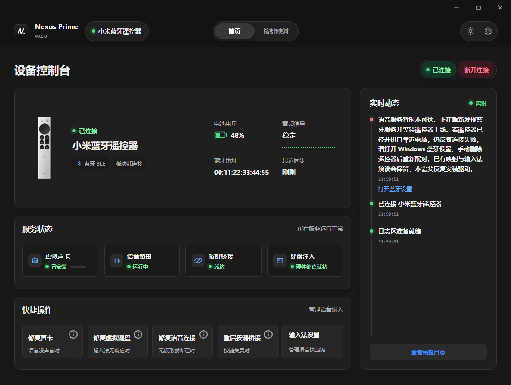
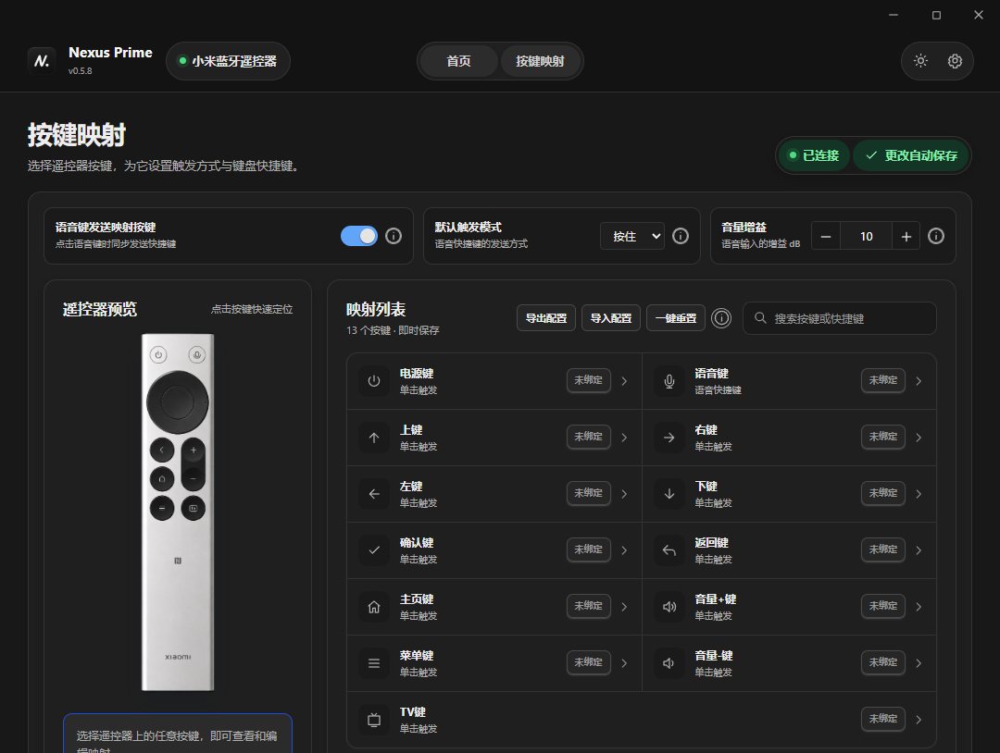
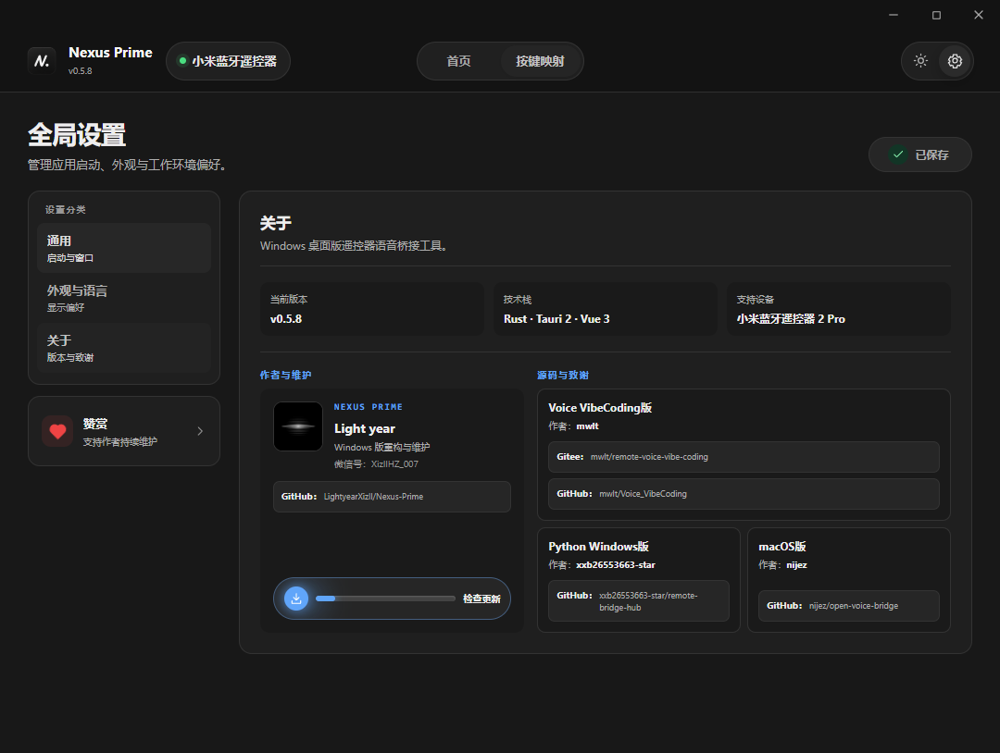

<p align="center">
  
</p>

<p align="center"><strong>Native · Lightweight · Local-first</strong></p>

<p align="center">
  面向 Windows 的小米遥控器 2 Pro 桌面桥接工具。<br />
  把遥控器按键变成可自定义的快捷键，把 ATVV 语音路由进输入法。<br />
  蓝牙、音频与 HID 全链路在本机回环完成，不需要 API Key，也不依赖远程服务器。
</p>

<p align="center">
  <a href="https://github.com/LightyearXizIl/Nexus-Prime/stargazers"></a>
  <a href="https://github.com/LightyearXizIl/Nexus-Prime/releases/latest"></a>
  
  
</p>

<p align="center">
  <a href="./LICENSE"></a>
  
  
</p>

<p align="center">
  <a href="https://github.com/LightyearXizIl/Nexus-Prime/releases/latest"></a>
  <a href="#使用方法"></a>
  <a href="https://github.com/LightyearXizIl/Nexus-Prime/issues"></a>
</p>

<p align="center">
  <a href="https://github.com/LightyearXizIl"></a>
</p>

<p align="center">
  <a href="#项目简介">项目简介</a> ·
  <a href="#最近更新">最近更新</a> ·
  <a href="#软件截图">软件截图</a> ·
  <a href="#功能特点">功能特点</a> ·
  <a href="#快速开始">快速开始</a> ·
  <a href="#使用方法">使用方法</a> ·
  <a href="#开发运行">开发运行</a> ·
  <a href="#项目目录结构">目录结构</a> ·
  <a href="#常见问题">常见问题</a> ·
  <a href="#开源许可证">许可证</a>
</p>

## 项目简介

Nexus Prime 是一款面向 Windows 的小米遥控器 2 Pro 桌面桥接工具。它通过蓝牙读取遥控器按键与 ATVV 语音数据，把按键转换为可自定义的键盘快捷键，并将语音路由到虚拟声卡，供输入法或其他语音软件使用。

| 项目 | 说明 |
| --- | --- |
| 当前版本 | v0.5.8 |
| 技术栈 | Rust · Tauri 2 · Vue 3 · TypeScript |
| 运行平台 | Windows 10 / 11（64 位） |
| 通信范围 | 蓝牙、PCM 与 HID 均绑定本机回环地址 |
| 开源许可 | MIT（第三方组件另计） |

> 本项目不需要 API Key、账号密码或远程业务服务器。音频和 HID 桥接均绑定本机回环地址。

## 最近更新

- **v0.5.8**（2026-11-14）：按 v0.5.6 恢复界面布局与居中导航，三个窗口按钮移至独立自绘标题栏；状态提示只在实时动态中完整换行，按键映射隐藏右侧滚动条但保留滚动，赞赏红心恢复实心与跳动。

- **v0.5.7**（2026-11-13）：增强语音连接恢复和驱动修复保护，修复配置写入竞争与重叠按键释放；更新 SVG 图标和自绘窗口控制，故障说明完整换行、导出完整脱敏日志。

- **v0.5.6**（2026-11-06）：手动组合新增符号分组和可增删的附加键，支持标点单独使用、多个按键组合，以及快捷键文本转为下拉继续编辑。
- **v0.5.5**（2026-10-20）：新增独立赞赏入口与微信、支付宝二维码，深色主题统一为中性黑灰，设置页保存状态合并为单个胶囊按钮。
- **v0.5.4**（2026-10-15）：微信“启动语音输入”改为单次按键序列，两种微信预设统一走 SendInput 兼容路线，输入法预设仅在配置保存成功后显示“当前已应用”。
- **v0.5.3**（2026-10-15）：新增“松开语音键后延迟恢复麦克风”（0–60 秒）与按键映射导入导出，诊断日志合并为单一脱敏文件。
- **v0.5.2**（2026-10-11）：麦克风路由改为复用的隐藏后台助手，不再重复启动路由进程，避免控制台窗口抢焦点。
- **v0.5.1**（2026-10-10）：修复麦克风路由闪退，改用隔离辅助进程，并补齐超时、设备拔出与用户手动改设备的失败保护。

详细变更记录见 [CHANGELOG.md](./CHANGELOG.md)。

## 软件截图

以下为 v0.5.8 浏览器预览，设备和服务状态使用模拟数据，不作为真实设备验收证据。页面沿用 v0.5.6 的布局，保留 SVG 图标重绘；三个窗口按钮位于独立自绘标题栏。

<p align="center">
  
</p>

| 按键映射 | 全局设置 |
| :---: | :---: |
|  |  |

截图文件统一存放在 [`image/`](./image/)。

## 功能特点

### 连接与自动恢复

- 区分已配对与真实蓝牙在线，遥控器关机时显示“已配对，等待遥控器”；
- 遥控器延后开机、重新连接或系统唤醒后，自动恢复 ATVV 和按键桥接；
- 检测端口或进程冲突，并提供 ATVV 修复与按键桥接重启；
- 连续订阅失败时退避重试并刷新软件会话；持续不可达时显示完整处理建议，可一键打开 Windows 蓝牙设置，按说明手动删除设备后重新配对。

### 按键映射

- 为电源、方向、确认、返回、主页、菜单、音量、TV 和语音键配置快捷键；
- 支持单击、双击、三击、四击和长按等触发方式及多键组合；
- “手动组合”可点选字母、数字、符号、功能键等，支持标点单独映射及多个普通键组合；
- 支持导出、导入按键映射配置，导入前校验格式与版本，失败保留原配置；
- 通过 HID Tap 处理返回键、音量键等系统 HID 报告。

### 语音链路

- 订阅 ATVV 语音通道，解码并路由音频到 VB-CABLE；
- 按住语音键临时切换默认麦克风，松开后默认等待 5 秒恢复，支持关闭延迟或调整为 0–60 秒；
- 内嵌 WinUHid 虚拟键盘：让豆包、微信等会过滤普通模拟按键的输入法，也能收到语音快捷键；
- 检测并修复 VB-CABLE 虚拟声卡环境。

### 诊断与日志

- 提供实时音频状态、连接日志和故障提示；
- 电脑环境、会话状态、构建标识与运行记录保存在同一日志中；界面和复制可显示末尾摘要，“导出日志”保留所选文件完整正文并脱敏。

### 界面与系统集成

- 首页提供声卡、虚拟键盘、ATVV 与按键桥接的一键修复，修复过程互斥并显示结果；
- 支持托盘运行、可选开机自启与登录时最小化、深浅主题和单实例启动；
- 深色主题采用中性黑灰；全局设置提供独立赞赏入口与微信、支付宝二维码；
- 功能图标统一使用 SVG，电池保留充电动画；独立自绘标题栏提供拖动、最小化、最大化/还原和关闭，双击空白拖动区可切换最大化。首页与按键映射在下方导航栏居中，主题和设置保留在导航右侧。关闭行为继续遵循“最小化到托盘”设置。
- 启动、连接及修复状态只在“实时动态”中完整换行显示，不在服务状态下方额外展开提示。按键映射隐藏页面右侧滚动条，保留滚轮、触控板和键盘滚动。

## 系统要求

### 运行软件

| 项目 | 要求 |
| --- | --- |
| 操作系统 | Windows 10 / 11，64 位 |
| 蓝牙 | 支持 BLE，且遥控器已在 Windows 中完成配对 |
| WebView | Microsoft Edge WebView2 Runtime |
| 语音路由 | VB-Audio VB-CABLE |

### 从源码开发

| 工具 | 要求 |
| --- | --- |
| Node.js | 18.x 或 20+，建议使用当前 LTS |
| npm | 随 Node.js 安装 |
| Rust | `rustup` 安装的 stable MSVC 工具链 |
| C++ 工具链 | Visual Studio Build Tools，勾选“使用 C++ 的桌面开发” |
| WebView2 | Windows 10/11 通常已安装 |

Windows 依赖可参考 [Tauri 2 官方准备工作](https://v2.tauri.app/start/prerequisites/)。

## 快速开始

### 使用发布版

从 [GitHub Releases](https://github.com/LightyearXizIl/Nexus-Prime/releases) 下载 NSIS 安装包：

- NSIS：`Nexus.Prime_0.5.8_x64-setup.exe`

当前正式版：[v0.5.8 Release](https://github.com/LightyearXizIl/Nexus-Prime/releases/tag/v0.5.8)。

安装步骤：

1. 下载与你的 Windows 架构匹配的安装包；
2. 运行安装程序；
3. 若系统提示缺少 WebView2，请安装 Microsoft Edge WebView2 Runtime；
4. 在 Windows 蓝牙设置中配对小米遥控器 2 Pro；
5. 启动 Nexus Prime，并按界面提示检查 VB-CABLE。

从旧版升级时直接运行新版安装包即可原位覆盖，不需要先卸载；按键映射、连击、长按与全局设置会继续保存在应用数据目录中。

VB-CABLE 安装可能需要管理员权限和重启。其许可证与再分发条件见 [第三方组件声明](./THIRD_PARTY_NOTICES.md)。

### 自动连接与等待状态

- 已配对但遥控器离线：保持等待，遥控器上线后自动恢复，无需点修复按钮。
- 蓝牙在线但语音订阅未完成：显示“已连接，语音连接中”；ATVV Control 和 Audio 都订阅成功才算语音就绪。
- 手动点击“断开连接”会停止本次自动恢复；再次点击连接或下次启动应用才重新启用。
- 状态依据 Windows 蓝牙链路，不依据是否最近按键或发送音频；离线清除电量，不删除配置、映射或输入法预设。
- “修复声卡”“修复虚拟键盘”“修复语音连接”及托盘重启共用恢复任务。Windows 操作超过监测时间时显示等待状态，实际任务仍保留归属，不会启动第二次修复。
- 只有确认驱动缺失才自动安装；已安装但端点未就绪或检测失败时不自动重装。安装器仍在运行时不会强制结束驱动安装。

> v0.5.8 已通过自动化检查与浏览器模拟界面检查。蓝屏根因仍需故障电脑的转储确认；真实遥控器、驱动生命周期、窗口拖动/最大化/关闭到托盘仍需安装后现场回归。

> v0.5.4 自动化与真机验收分开记录。本机用户已确认微信 Ctrl+Win 可由遥控器调用、“按住说话”在开启“始终使用遥控器麦克风”时可用；在本版前置固件按键拦截调整后，用户进一步确认本次微信语音真机验收已完成。该结论依据用户现场反馈，不代表所有电脑或输入法均已验证。千问闲置后首次按键的波形等待尚未确认根因，不能把音频发送成功等同于输入法已开始识音。

### 自动更新机制

应用内自动更新会优先读取 GitHub Release 随包发布的 `latest.json`，避免 GitHub API 的匿名请求额度影响检查；仓库清单和 GitHub API 仅作为兼容回退。发布新版本时请使用 `vX.Y.Z` 标签，并上传唯一的 `Nexus.Prime_X.Y.Z_x64-setup.exe` 安装包及其 `latest.json`；清单提供安装包 SHA-256，下载完成后仍会校验完整性。

若 v0.3.6 或 v0.3.7 的“检查更新”提示 GitHub `403` 或“检查失败”，请直接下载安装 v0.3.9；旧版没有清单优先与限流恢复机制，重启应用不会修复 GitHub 的匿名请求额度。v0.3.9 在“自动检查更新”开启时会在启动、每 6 小时、窗口恢复且到期时检查；限流响应含恢复时间时会提前自动重试。

### 从源码构建安装包

完成“开发运行”中的环境准备后执行：

```powershell
npm ci
npm run tauri:build
```

常见产物位于：

```text
src-tauri/target/release/nexus-prime.exe
src-tauri/target/release/bundle/msi/
src-tauri/target/release/bundle/nsis/
```

## 使用方法

1. 在 Windows 设置中完成遥控器蓝牙配对；
2. 启动 Nexus Prime，等待首页显示“已连接”；
3. 打开“按键映射”，为每个遥控器按键设置触发方式和快捷键；
4. 点击遥控器卡片或列表项可快速定位对应映射；
5. 如需语音输入，在首页运行“声卡检测与修复”，确认 VB-CABLE 已安装；
6. 关闭“始终使用遥控器麦克风”时，程序按下语音键会临时切到 `CABLE Output (VB-Audio Virtual Cable)`，松开后恢复原默认录音设备；目标输入法需要从 CABLE 接收遥控器音频，若它固定选择了其他麦克风，请核对其录音设备设置；
7. 确保输入法听写快捷键与 Nexus Prime 中的语音键映射一致；千问输入法可选 `左 Ctrl`、`左 Ctrl + 左 Win`、`左 Win + 左 Alt` 或 `右 Alt`，请在“输入法设置 → 千问”中应用与千问一致的一项。微信输入法有两种语音模式：“启动语音输入”使用 `左 Ctrl + 左 Win`，“按住说话”使用 `左 Ctrl + 左 Shift + D`。请在 Nexus Prime 的输入法设置中应用与微信输入法相同的模式；即使微信输入法同时启用两项，Nexus Prime 每次也只会发送当前选择的一种。“按住说话”会在遥控器松开时结束并把文字放入当前输入框，不会自动发送 Enter；
8. 如果网页键盘测试能显示按键、但豆包或微信没有反应，在首页点击“修复虚拟键盘”，接受 Windows 管理员确认；如结果提示需要重启，请重启 Windows 后再测试；
9. 若音频无波形或出现“ATVV 未连接”，使用“修复 ATVV 连接”；
10. 关闭窗口时可按设置最小化到托盘，之后从托盘重新打开或退出。

首次启动默认显示设置界面，不会自动开启开机自启。完成配置后，可在“全局设置”开启“开机自启”；若同时开启“开机自启时最小化到托盘”，仅 Windows 登录自启会隐藏主窗口，手动启动仍会显示窗口。

首次启用 HID Tap、安装虚拟键盘或安装虚拟声卡时，Windows 可能显示 UAC 提权提示。VB-CABLE 对话框中的“下载官方驱动包”会让你选择保存位置，再校验 HTTP 状态、大小、ZIP 头和固定 SHA-256；完成后只提示手动解压安装，不会自动提权或安装。也可以从 [VB-Audio 官方下载页](https://vb-audio.com/Cable/) 打开官网；其 Donationware 与分发限制请参阅 [VB-Audio 授权说明](https://vb-audio.com/Services/licensing.htm)。

### 麦克风恢复延迟

在“全局设置 → 通用”中设置“松开语音键后延迟恢复麦克风”，默认开启并等待 5 秒，可调整为 0–60 秒；关闭或设置为 0 时立即恢复。该延迟只作用于默认麦克风恢复，语音快捷键仍在松手时立即释放。

等待期间再次按下语音键会取消上次恢复；如果你手动选择了其他默认麦克风，程序保留你的选择。“始终使用遥控器麦克风”开启时不执行松手恢复；断连、重启桥接、切换模式和退出会立即清理。临时路由不会把输入法永久固定到 CABLE，日常使用的无线麦克风可以继续保留。

### 导入与导出映射

“按键映射”页的“导出配置”和“导入配置”只处理遥控器按键映射，不包含电脑环境、蓝牙信息或全局麦克风设置。导入时先校验文件格式、版本与字段，通过后一次性替换映射；失败时保留当前配置，并显示错误原因。

### 手动组合快捷键

在“按键映射”页点击“手动组合”，可为当前按键和触发方式设置快捷键，不依赖系统键盘钩子：

- **快捷键文本**：直接输入，例如 `Alt+F4`、`Ctrl + ?`；加号请写 `Plus`。点击“改用下拉”可把文本转换为下拉选项继续编辑；
- **下拉选择**：分别选择修饰键与主键，Ctrl、Shift、Alt 可选左、右或任意，Win 可选左或右；主键按字母、数字、符号、功能键、编辑与导航、媒体与系统分组；
- **附加键**：点击“添加按键”可追加多个普通键，例如 `Ctrl + , + .`、`A + .`，每个附加键都可替换或移除；
- 问号等需要 Shift 的符号会自动加入 Shift，已选的左、右 Shift 保持不变；Shift 作用于整组按键，最终输出的字符取决于键盘布局和输入法；
- 文本无效、物理按键重复或组合为空时无法应用；“组合预览”显示实际发送的按键；
- 沿用原有映射格式，已有映射和导入导出文件无需迁移。虚拟键盘无法编码的组合会自动改用 SendInput 发送。

### 电池显示

Nexus Prime 保持自身的电池图标和充电动画。电量大于等于 30% 为绿色，10%–29% 为黄色，低于 10% 为红色；设备未上报电量时显示灰色空电池和“—”。充电流光仅在电量已知且设备明确上报充电时显示，不会把低电量改成绿色。

## 开发运行

### 1. 获取源码

```powershell
git clone https://github.com/LightyearXizIl/Nexus-Prime.git
cd Nexus-Prime
```

项目主页：[GitHub：LightyearXizIl/Nexus-Prime](https://github.com/LightyearXizIl/Nexus-Prime)

### 2. 安装依赖

```powershell
npm ci
```

`package-lock.json` 和 `src-tauri/Cargo.lock` 已纳入版本控制，用于复现依赖版本。

### 3. 启动桌面应用

```powershell
npm run tauri:dev
```

首次编译 Rust 依赖会花费较长时间。

### 4. 仅启动前端

```powershell
npm run dev
```

仅启动前端时无法使用蓝牙、音频、托盘和本地 IPC 功能。

### 5. 运行检查

```powershell
npm test
cargo test --manifest-path src-tauri/Cargo.toml --workspace
npm run build
cargo check --locked --all-targets --manifest-path src-tauri/Cargo.toml
npm run tauri -- build --debug --no-bundle
```

`npm test` 依次运行 Gadget 的 Node 测试（`tests/`）和 Vitest 前端测试；少数 Rust 测试依赖真实硬件或桌面环境，默认标记为 ignored。

如果 PowerShell 的执行策略阻止 `npm.ps1`，可使用：

```powershell
npm.cmd ci
npm.cmd run tauri:dev
```

## 环境变量

项目不需要真实密钥。可选变量已集中记录在 [`.env.example`](./.env.example)。

Rust 后端不会自动读取 `.env` 文件；需要覆盖变量时，请在启动前通过终端设置：

```powershell
$env:RUST_LOG = "info"
npm run tauri:dev
```

常用变量：

| 变量 | 用途 |
| --- | --- |
| `TAURI_DEV_HOST` | 指定 Tauri/Vite 开发主机；不设置时仅本机访问 |
| `RUST_LOG` | 开发日志过滤级别 |
| `NEXUS_BUILD_ID` | 可选编译期构建标识，写入诊断环境快照；未设置时为 `local-development` |
| `REMOTE_BRIDGE_XIAOMI_HID_TAP_PORT` | 覆盖 HID Tap 本地端口，默认 `30684` |
| `REMOTE_BRIDGE_PCM_PORT` | 覆盖 PCM 语音路由 UDP 端口，默认 `31680` |
| `REMOTE_BRIDGE_XIAOMI_GADGET_ARCHIVE` | 指定本地 Frida Gadget 压缩包 |
| `REMOTE_BRIDGE_XIAOMI_VB_CABLE_ZIP` | 指定本地 VB-CABLE ZIP |
| `REMOTE_BRIDGE_WINUHID_DLL` | 指定本地 WinUHid DLL |
| `REMOTE_BRIDGE_XIAOMI_RUNTIME_ID` | 覆盖 ProgramData 中的运行目录名 |
| `REMOTE_BRIDGE_XIAOMI_FORCE_GATT_HID` | 高级兼容开关；仅在明确需要时设为 `1` |

`REMOTE_BRIDGE_LOG_DIR`、`REMOTE_BRIDGE_LOG_PATH`、`REMOTE_BRIDGE_LOG_RETENTION_DAYS` 和 `REMOTE_BRIDGE_PARENT_PID` 由应用启动时自动设置并传给子进程，无需手动配置。

不要把真实凭据或包含个人路径的 `.env` 提交到仓库。

## 本地端口与数据

- PCM 语音路由：UDP `127.0.0.1:31680`
- HID Tap：TCP `127.0.0.1:30684`
- Vite 开发服务器：`http://localhost:1430`

这些服务默认只监听本机回环地址，不是公网服务器。

应用配置和日志写入 Windows 应用数据目录，不应存放在源码仓库。运行日志按日保存为 `app-YYYY-MM-DD.log`，默认保留最近 7 天，可在“全局设置 → 通用”中改为 1、3、7、14 或 30 天；单日超过 10MB 会创建连续分段但不会提前丢弃内容。

电脑环境、应用版本、设备与语音会话摘要和运行事件写在同一个 `.log` 中。“复制日志”与“导出日志”使用同一份脱敏内容，不需要另找诊断包；当前日志会刷新环境与运行摘要，旧日志保留当时已有的信息，不会补入今天的电脑环境。日志记录会话、事件序号和音频阶段耗时，帮助区分快捷键、ATVV、解码、UDP 与输出状态；这些记录不能证明输入法已经识音或提交文字。分享前仍可检查日志内容，确认没有其他需要隐藏的个人信息。

## 项目目录结构

```text
.
├── .github/workflows/             # Windows 构建工作流（手动或指定分支触发）
├── docs/                          # 设计与实施计划
├── image/                         # README 横幅与软件截图
├── public/                        # 前端静态资源
├── src/                           # Vue 3 前端
│   ├── assets/                    # 图片与使用引导
│   ├── components/                # 设备状态、导航、按键映射与手动组合组件
│   ├── i18n/                      # 简体中文、繁体中文与英文文案
│   ├── router/                    # 前端路由
│   ├── stores/                    # Pinia 状态
│   ├── types/                     # TypeScript 类型
│   ├── utils/                     # 快捷键、电池、连接状态与输入法预设工具
│   └── views/                     # 首页、映射和全局设置页面
├── src-tauri/                     # Tauri / Rust 后端
│   ├── assets/                    # 运行所需脚本与第三方资源
│   ├── capabilities/              # Tauri 权限
│   ├── examples/                  # 诊断示例
│   ├── icons/                     # 桌面与移动端图标
│   ├── windows/                   # NSIS 安装包模板
│   └── src/
│       ├── audio/                 # PCM、UDP 与 VB-CABLE
│       ├── bridges/               # BLE、HID Tap 与按键处理
│       ├── config/                # 配置管理
│       ├── ipc/                   # Tauri 命令与托盘
│       ├── logging.rs             # 日志与脱敏
│       └── update.rs              # 应用内更新检查
├── tests/                         # Gadget Node 测试
├── third-party-licenses/          # 第三方许可证原文
├── .env.example                   # 可选环境变量模板
├── CHANGELOG.md                   # 更新日志
├── CONTRIBUTING.md                # 贡献指南
├── HANDOFF.md                     # 开发交接与验收记录
├── LICENSE                        # 项目自有源码的 MIT License
├── THIRD_PARTY_NOTICES.md         # 第三方组件与再分发说明
├── latest.json                    # 应用内更新清单（与 Release 资产一致）
├── package.json
└── README.md
```

## 常见问题

### 找不到遥控器或一直连接失败

确认遥控器已在 Windows 蓝牙设置中配对，并关闭可能同时占用该设备的旧版桥接程序。随后重新启动 Nexus Prime。

### 网页键盘测试有按键，但豆包、微信等输入法没有反应

先确认首页音频信号正常、输入法麦克风为 `CABLE Output`，并核对输入法与 Nexus Prime 中实际选择的听写快捷键。网页收到按键不能证明输入法已响应，需结合发送路线和真实语音面板判断。

v0.5.4 的微信两种预设使用 SendInput，日志为 `route=send_input`。千问、豆包等保留虚拟键盘优先策略，日志为 `route=virtual_hid`；WinUHid 不可用时回退为 `route=send_input_fallback`。出现虚拟键盘降级提示时，可在首页点击“修复虚拟键盘”，按提示完成后再试。这些路线日志只说明程序的发送方式，不等同于输入法已打开面板或识别到文字。

如果按一次遥控器语音键出现两个微信语音面板，请在 Nexus Prime 的“输入法设置 → 微信”重新应用所需模式。旧版 `wechat-hold` 配置会自动迁移到推荐的“按住说话”（`左 Ctrl + 左 Shift + D`），避免把微信的 Ctrl+Win 启动快捷键当成长按组合持续发送。

语音键每次按压只会建立一个会话：微信 Ctrl+Win 在 DOWN 完成一次短脉冲；微信 Ctrl+Shift+D 与千问的四种语音快捷键均在 UP 按原路径释放。F5、Ctrl、Win 的固件泄漏仅在本次语音周期内被处理；若日志出现 `hook bump timed out`、`modifier recovery` 或 `release recovery`，请保留当天日志用于排查。

### 显示“ATVV 未连接”

点击“修复语音连接”。应用会检查已知冲突并刷新桥接会话，重新订阅语音通道。若持续报告“语音服务不可达”，先确认遥控器已开机且靠近电脑，再通过实时动态中的“打开蓝牙设置”删除设备并重新配对。软件不会自动删除配对；重新配对使系统服务缓存失效，但不能仅凭这一操作恢复就断定具体根因。

### 返回键或音量键无效

尝试“重启按键桥接”。HID Tap 需要访问 Windows HID 主机进程，首次启动可能要求管理员权限。

### 端口被占用

不要同时运行旧版 Python 桥接或另一个 Nexus Prime 实例。默认冲突端口为 `31680` 和 `30684`。

### `npm` 在 PowerShell 中提示禁止运行脚本

使用 `npm.cmd`，或根据组织安全策略调整 PowerShell 执行方式。无需为了运行本项目关闭系统安全软件。

### 构建 MSI 失败

确认 Visual Studio C++ Build Tools 已安装；构建 MSI 时还可能需要启用 Windows 的 VBSCRIPT 可选功能。参见 Tauri 官方 Windows 安装包文档。

## 安全与隐私

- 仓库不应包含 `.env`、API Key、Token、密码、Cookie、私钥或签名文件；
- 不要提交真实蓝牙 MAC、用户目录、日志、录音、注册表导出或崩溃转储；
- `.gitignore` 已覆盖常见环境变量文件、凭据、密钥、日志、构建目录和本地数据；
- 提交前建议再次执行敏感信息扫描并检查 `git diff --cached`。

如发现安全问题，请不要在公开 Issue 中粘贴密钥、完整日志或设备标识。

## 第三方组件

项目可能随应用使用：

- VB-Audio VB-CABLE；
- Frida Gadget；
- 内嵌的 WinUHid 虚拟键盘组件与驱动。

它们不属于本项目 MIT License 的授权范围。来源、校验值和再分发注意事项见 [THIRD_PARTY_NOTICES.md](./THIRD_PARTY_NOTICES.md)。

## 参与贡献

欢迎提交 Issue 和 Pull Request。请先阅读 [CONTRIBUTING.md](./CONTRIBUTING.md)，并确保提交内容不含个人数据、设备标识或无授权的第三方资源。

## 开源许可证

项目自有源码采用 [MIT License](./LICENSE)。

MIT License 允许使用、复制、修改、合并、发布、分发、再许可和销售软件副本，但必须保留版权与许可声明，且软件按“原样”提供、不附带担保。

第三方组件、品牌和资源继续受各自条款约束，详见 [第三方组件声明](./THIRD_PARTY_NOTICES.md)。

## 致谢与相关项目

- Nexus Prime
  - 作者：Light year
  - GitHub：[LightyearXizIl/Nexus-Prime](https://github.com/LightyearXizIl/Nexus-Prime)
- Voice VibeCoding版
  - 作者：mwlt
  - Gitee：[mwlt/remote-voice-vibe-coding](https://gitee.com/mwlt/remote-voice-vibe-coding)
  - GitHub：[mwlt/Voice_VibeCoding](https://github.com/mwlt/Voice_VibeCoding)
- Python Windows版
  - 作者：xxb26553663-star
  - GitHub：[xxb26553663-star/remote-bridge-hub](https://github.com/xxb26553663-star/remote-bridge-hub)
- macOS版
  - 作者：nijez
  - GitHub：[nijez/open-voice-bridge](https://github.com/nijez/open-voice-bridge)

<p align="center"><sub>Windows 10 / 11 · 小米遥控器 2 Pro · MIT License</sub></p>
